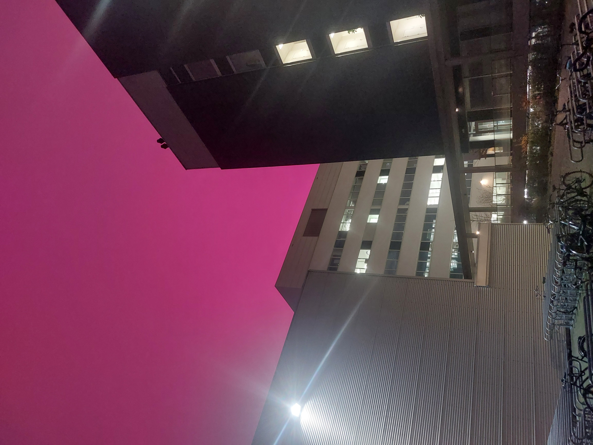
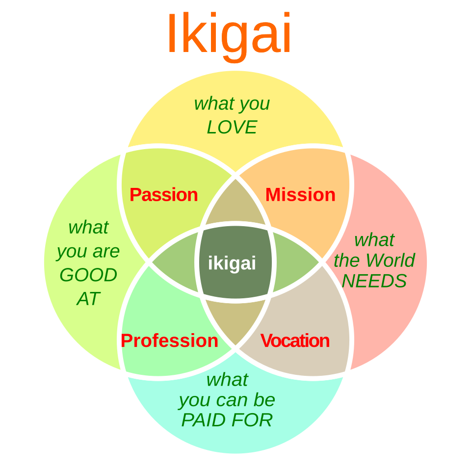
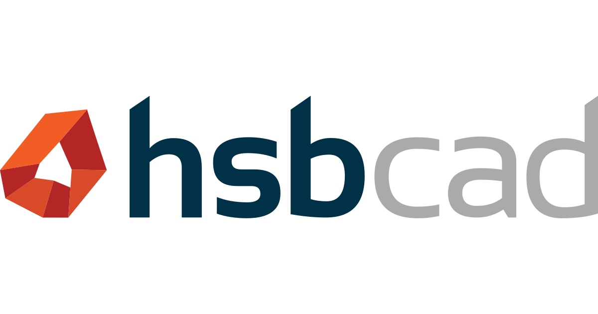

# Successfully merged branch "School" into "origin/main"

On July 2nd 2026, I impatiently opened [Ghent University](https://www.ugent.be)'s web portal to
get my scorecard, which has always been released at the announced hour on the dot,
and not a minute later. 16:00 comes around and I can breathe a sigh of relief:
I have — after 5 years of relentless keyboard-smashing and what is likely to be
multiple thousands of coffees — graduated with a Master's in Computer Science &
Engineering.

Although I can vividly recall the many all-nighters I had to pull during exam
season (the likely culprit for my coffee addiction which I developed as a measly first-year!),
I have to say that overall my studies were extremely enjoyable. I have been able
to learn a great deal about mathematics, computer science, electronics and many other engineering
disciplines, and all of this from some of the top professors in Belgium.

I was given the opportunity to write a thesis on speeding up physics simulations on the GPU,
something I've been drawn towards since my time at [NTNU](https://www.ntnu.edu/).
That thesis taught me a lot, not just about GPU programming or physics, but about
writing, perseverance, planning and preparation. I would like to say that writing
that 100-page behemoth was an easy feat and that naturally I scored extraordinarily high for my work,
but this would make my nose grow to the point of touching my monitor as of writing this (Pinocchio reference, get it?).
I spent a lot of time solving small problems that were likely of the most trivial kind for my more talented peers.

And still, I enjoyed it. I enjoyed the topic I chose, even though it was way out of my comfort zone.
I enjoyed the conversations about physics I got to have with my promotors and the PhD students and postdocs in the office.
I enjoyed walking around the Zwijnaarde Tech Lane campus trying to mentally solve the next CUDA runtime error,
like an off-brand, poorly imitated Einstein at Princeton.

<figure>

<figcaption>The sky in the Tech Lane Science Park has become pink: a bio-engineering company is incubating plants in a greenhouse.</figcaption>
</figure>

# `git switch -c work`

Now a new phase begins. I have gathered all of this knowledge and have to do something with it, something meaningful.
My first ambition was to pursue a PhD in the field of GPU computing.
After submitting my thesis however, it became more and more clear that another path had to be trodden.
I was excited about developing every new piece of code in my thesis, but I lacked a sort of rigour when researching.
I would add a new feature that in my mind would naturally improve performance, which was often the case, but sometimes not.
And in academia, a result really should have theory explaining not only the how, but the why. The scientific method is
probably the principal reason for mankind's progression over the last centuries, but somehow my mind didn't want
to embrace it, not yet at that time at least. It preferred to throw code at the canvas like a crazed futuristic
Da Vinci, creating an elegant but at times illogical ensemble.

So I set my sights on the professional world. The tech scene in Ghent has never been more alive than it is today.
Especially [TechWolf's $100+ million acquisition by SAP](https://www.vrt.be/vrtnws/nl/2026/10/06/sap-techwolf-gent-overname/) — making it the largest tech acquisition in Belgian
history — cannot be overstated.

Choosing an employer turned out to be both easy and hard. Easy in the sense that,
whatever your neighbour likes to tell you about AI taking your job, there are,
at the time of writing at least, tons of jobs in the IT scene.
Hard in the sense that I look for more than an income in my work.

You may or may not have heard of [*Ikigai*](https://en.wikipedia.org/wiki/Ikigai), the Japanese concept of a "reason for being".
A popular take on *Ikigai*, accompanied by a well-known diagram, states that doing something:
1. Which you **love**,
2. which you're **good at**,
3. which is **lucrative**,
4. which other people **need**,

eventually leads to a fulfilling life.

<figure>

<figcaption>An example Ikigai diagram. Source: <a href=https://en.wikipedia.org/wiki/Ikigai#/media/File:Diagramo_de_Ikigajo_-en.svg>Wikipedia</a></figcaption>
</figure>

I do not want to toot my own horn, but I would say that any job within my domain
would have conformed to the first 3 categories. But category 4 is different.
There are many ways in which people can be helped through business. You could say
that a business that runs well fills a need and is helpful in that sense.
But naturally I think we can all come up with some counterexamples in our heads.
With the current climate change situation, I was glad to come across a company that not only develops interesting
software, but helps an especially important industry for the future, namely the wood construction and fabrication industry.
I am glad to call [hsbcad](https://www.hsbcad.com/about) my new home.

<figure>

<figcaption>The logo of hsbcad.</figcaption>
</figure>

I could ramble off all of the company's core values in this blog post, but the core of what makes it unique is much simpler than that:
hsbcad has existed since 1998 as a software firm for designing wood construction elements, and now employs over 80 people worldwide and has a growing customer base.
It has been a family software business for nearly all of its existence, and I believe the founders's vision is what has shaped the product to be such a success.
In the two weeks I've been here, I've already been taught a ton about software engineering by some incredibly experienced and incredibly nice people.

# `assert ((end && beginning) == true);`

The beauty of human nature is that big changes rarely come only with
negative experiences. Oftentimes losing something, such as a lively student life,
brings with it other new, exciting experiences.
But I would argue that even true setbacks make us humans more appreciative of what we do have.
We truly are an incredibly adaptable species. And even though I've had to say goodbye to
what will always remain a very memorable 5 years of my life, I am sure that the future holds plenty of pleasant surprises for me,
but also for you, kind reader who has made it to the end of my first blog post.

Signing off,

-Nathan M.
